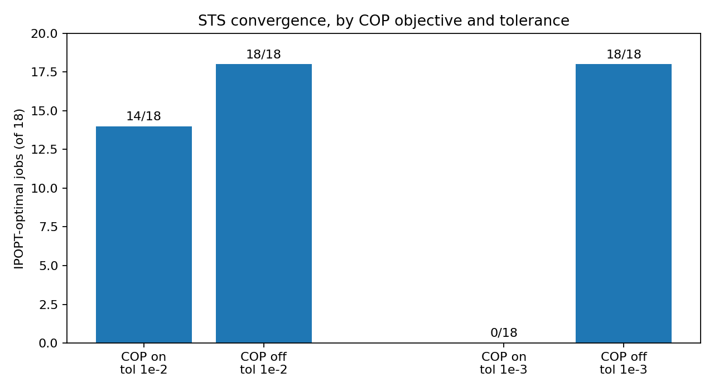
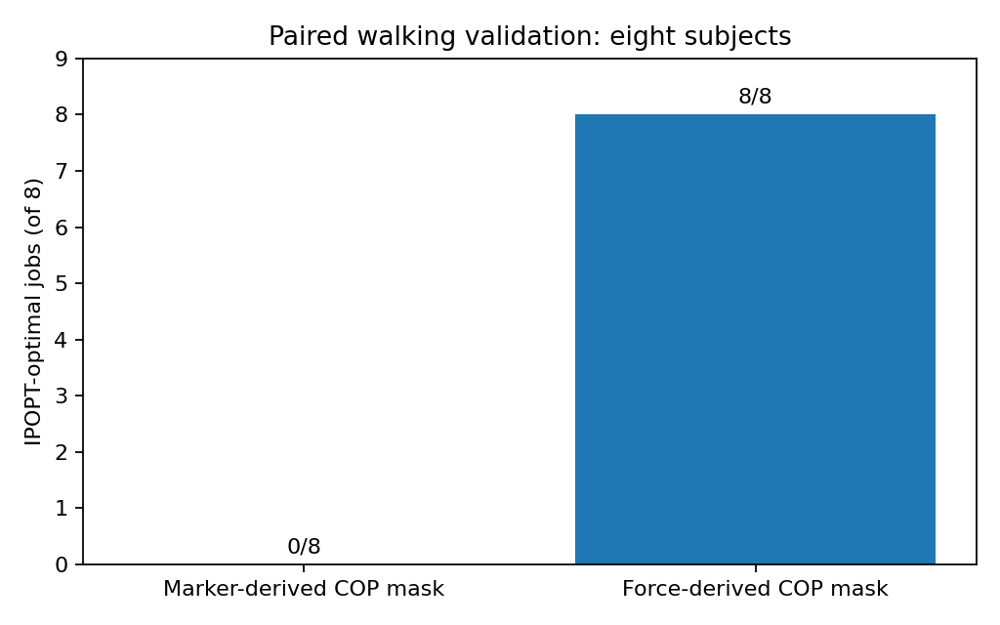

# OpenSimAD torque-driven STS: numerical study closeout

**Analysis snapshot:** October 12, 2026
**GitHub closeout prepared:** November 8, 2026
**Status:** Numerical convergence sweep complete; **biomechanical validation not yet complete**.

This directory documents a 72-case torque-driven sit-to-stand (STS) factorial sweep and a 16-case paired walking validation, run with OpenSimAD, CasADi/IPOPT, and HTCondor. The primary objective is a musculoskeletal simulation that both converges **and** tracks measured ground reaction forces (GRF), center of pressure (COP), and realistic human motion.

## Main results

| Batch | IPOPT optimal | Nonoptimal | HTCondor completed | Result archives |
|---|---:|---:|---:|---:|
| STS E015–E086 | **50 / 72 (69.4%)** | 22 (15 iteration-limit, 7 step-error) | 72 / 72 | 72 / 72 |
| Walking E111–E126 | **8 / 16 (50%)** | 8 (4 restoration, 3 step-error, 1 iteration-limit) | 16 / 16 | 16 / 16 |

### STS: COP objective and convergence

| COP tracking + monotonic terms | IPOPT tolerance 1e-2 | IPOPT tolerance 1e-3 | Combined |
|---|---:|---:|---:|
| ON | 14/18 | **0/18** | **14/36 (38.9%)** |
| OFF | 18/18 | 18/18 | **36/36 (100%)** |



The COP switch in this sweep changes **two** objective terms simultaneously (`copTrackingTerm` and `copMonotonicTerm`). This design demonstrates sensitivity to their combined inclusion, not which individual term is responsible. Also, an optimal solution at a relaxed tolerance need not pass a stricter one.

### Walking: COP-validity masks

All eight **force-derived** COP-mask cases were IPOPT-optimal; no **marker-derived** COP-mask case was optimal, comparing paired cases within each subject (3–10). Gait-event timing was marker-derived **in both cases**; only the COP mask differed. Force-derived masks used measured vertical GRF >20 N and are therefore laboratory validation inputs, **not** automatically available in video-only deployment.



**The key limitation:** an IPOPT `Optimal Solution Found` message does not prove plausible motion, accurate GRF/COP, or acceptable pelvis residual forces. An earlier positive-control walking run (E009) converged but showed an unrealistic initial right-foot movement. Treat all results here as *solver-outcome* evidence until the separate biomechanical QA is completed.

## Files and traceability

- `data/sts_outcomes_transcribed_2026-10-12.csv`: all 72 IDs; IPOPT-optimal IDs and iteration/NLP values are transcribed from the terminal collector. For the 22 nonoptimal cases, the **per-ID failure category is not available in the pasted terminal output**. Obtain it from `sts_sweep_outcomes.csv` on CHTC before detailed failure attribution.
- `data/sts_factorial_reconstructed_from_handoff.csv`: factor combinations **reconstructed from handoff loop order**; not a substitute for the original machine-readable manifest.
- `data/walking_outcomes_transcribed_2026-10-12.csv`: exact per-ID walking `EXIT:` messages.
- `data/sts_convergence_by_factor.csv`: descriptive rates computed from the reconstructed design and observed optimal IDs.
- `docs/provenance.md`: job clusters, source hashes and data limitations.
- `docs/validation_and_next_steps.md`: how to evaluate biomechanics and what remains unresolved.
- `scripts/rebuild_summary.py`: checks data integrity, recomputes summary counts (Python standard library only).
- `scripts/collect_source_on_chtc.sh`: optional **read-only** source snapshot from the CHTC repository, without study participant data or credentials.

## Run the summary check

```bash
python3 scripts/rebuild_summary.py
```

## Reproducibility boundaries

The *actual* runnable code, trial input datasets, original manifests, and force/motion output archives are on the UW–Madison CHTC system or the researcher's Windows workspace. This GitHub-ready closeout contains a transparent, source-based **summary**, not a complete standalone simulation environment. Do **not** upload `.env`, raw subject datasets, identifiable videos, internal credentials, bulk result archives, or licensed journal PDFs to a public repository. Confirm redistribution permission for any third-party source borrowed from upstream codebases.

No new jobs were submitted as part of this closeout. Proposed E010–E014 and E087–E110 are **not registered as submitted**.
